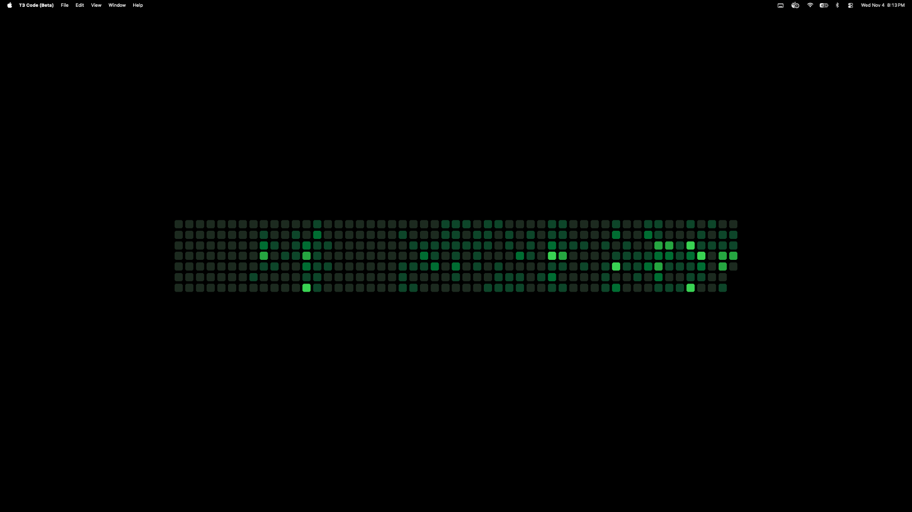

# gh-heatmap

Your public GitHub contribution graph as your macOS desktop wallpaper: green squares on
black by default, or one of five built-in themes, refreshed every 10 minutes by a per-user
launchd job. Or, with `--mode t3code`, your T3 Code usage instead (see below).
No GitHub token; it reads only `https://github.com/users/<username>/contributions`.
Design contract: [SPEC.md](SPEC.md).



## Install / uninstall

Requires [uv](https://docs.astral.sh/uv/) on your `PATH`.

```sh
python3 install.py --user YOUR_GITHUB_NAME     # optional: --mode t3code, --theme nord, --width 40%, --watch-spaces
python3 uninstall.py
```

`install.py` runs `uv sync --locked`, writes your config, runs the tool once by hand
(this changes your wallpaper and saves the original), then loads the LaunchAgent. It
schedules nothing unless that first run succeeds and the original wallpaper was saved.
`uninstall.py` unloads and deletes the agent, then runs `heatmap.py --uninstall`. That
restores the original wallpaper and deletes the files below (except the empty lock file), holding the lock the
whole time. It deletes nothing while any display still shows a heatmap image. In that
case it names those displays, opens Wallpaper settings, prints your original wallpaper
paths and exits 1. Re-pick a wallpaper there, then run `uninstall.py` again. That is
always safe to repeat. Without `.venv` it deletes nothing and asks you to run
`uv sync --locked` first.

To try it without changing anything:

```sh
uv run heatmap.py --dry-run --user YOUR_GITHUB_NAME
open ~/Library/Application\ Support/gh-heatmap/preview.png
```

## Themes

`dracula`, `gruvbox`, `nord`, `panda` and `tokyo-night`, each built from that palette's
official colours. With no theme set you get the GitHub green look. Pick one when
installing (`install.py --theme nord`) or change it any time:

```sh
uv run heatmap.py --list-themes
uv run heatmap.py --dry-run --theme dracula     # preview only; saves nothing
uv run heatmap.py --theme dracula               # save it and apply it now
uv run heatmap.py --theme default               # back to green
```

Names are case-insensitive. The choice is saved in `config.json`, so the scheduled runs
keep it, and a reinstall keeps it unless you pass a different `--theme`.
Only the desktop you are on changes at once. Other desktops (Spaces) switch the next
time a run happens while you are on them; run `uv run heatmap.py` there to switch now
(during a GitHub backoff it skips, like any other run).

## Size

By default the grid fills about 62% of the screen's width. `--width` and `--height` set the
largest it may be, as a percentage of the screen (10% to 100%, the `%` is optional):

```sh
uv run heatmap.py --dry-run --width 40%          # preview only; saves nothing
uv run heatmap.py --width 40%                    # at most 40% of the screen wide
uv run heatmap.py --height 15%                   # at most 15% of the screen tall
uv run heatmap.py --width 80% --height 40%       # fits inside both
uv run heatmap.py --width default                # forget the saved width
```

The squares stay square, so the grid grows until it reaches either limit. A year of
contributions is about 7.5 times wider than tall, so usually the width wins: `--width 80%
--height 40%` gives a grid about 80% wide and 16% tall. Each flag is saved on its own, so
`--width 80%` keeps a height you saved earlier; a dimension you never set (or set back to
`default`) is unlimited. So `--height` on its own can make the grid bigger than the
default: `--height 25%` hits the screen's width first and runs nearly edge to edge (about
20% tall on a 16:10 screen); pair it with `--width` to keep it smaller. Like the theme, the size is saved in `config.json`, applies to every display
in proportion to its own size, and is kept on a reinstall unless you pass the flag again.

## T3 Code mode

Instead of GitHub contributions, the squares can show how much you used T3 Code: one square
per day, coloured by how many runs (turns sent to an agent) started that day.

```sh
uv run heatmap.py --dry-run --mode t3code       # preview only; saves nothing; needs no install
uv run heatmap.py --mode t3code                 # save it and apply it now
uv run heatmap.py --mode github                 # back to your GitHub graph
```

It reads T3 Code's local database, `~/.t3/userdata/statev2.sqlite`, read-only, and makes no
network request. Only the start time of each run is read, never what was said. A square's
colour is relative to your own busier and quieter days in the last year: roughly a quarter
of the days you used T3 Code land on each of the four colours. Themes, sizes and the saved
setting work exactly as in GitHub mode.

Good to know:

- The database layout belongs to T3 Code and can change in any update. If it does, this
  mode logs an error and leaves your wallpaper as it was until `heatmap.py` is updated;
  GitHub mode is unaffected.
- History starts when T3 Code started keeping it; earlier days are empty.
- Every run counts, including runs by subagents, delegated tasks and scheduled tasks.
- `--user` has no effect in this mode and is an error; `install.py` still asks for it.

Not affiliated with or endorsed by T3 Tools.

## Other flags

`--force` (skip the ETag and up-to-date checks and re-render on every display;
it still respects a GitHub backoff and still falls back to cached data when offline) and
`--restore` (put the saved wallpaper back; deletes nothing). Exit codes: 0 means OK,
1 means error (including an unknown theme or mode, a bad size, a bad flag, or T3 Code's
database missing or unreadable), 2 means skipped (no screens, backoff, or another run in progress), and 3
means `--restore`/`--uninstall` found the lock busy.

## Files it creates

```
~/Library/Application Support/gh-heatmap/   config.json, state.json, backup.json,
                                            heatmap-<hash>.png, preview.png
~/Library/Application Support/gh-heatmap.lock   empty lock file; uninstall leaves it on
                                            purpose, so every run shares one lock
~/Library/Logs/gh-heatmap.log               (plus rotated .1-.3, 512 KiB each)
~/Library/Logs/gh-heatmap.launchd.log       launchd stdout/stderr; should stay empty
~/Library/LaunchAgents/local.gh-heatmap.plist
~/Library/LaunchAgents/local.gh-heatmap.spaces.plist   only with --watch-spaces
```

Plus `.venv/` in this folder. Nothing outside `$HOME`, no sudo, no shell-rc edits.
In T3 Code mode, reading T3 Code's database can also create or update SQLite's own
`statev2.sqlite-shm` / `-wal` files next to it (for example when T3 Code isn't running), as
any reader of that database does; the database itself is never changed.

## Limitations

- **Current Space only.** macOS has no public API to set the wallpaper on every
  Space, so each screen's *current* Space is updated. Other Spaces, and displays that
  aren't connected, keep the heatmap they last showed. They catch up on the next
  successful run while you are on them (normally within 10 minutes; a GitHub backoff,
  sleep or a failed run can delay it), or at once if you run `uv run heatmap.py` there
  (unless GitHub asked us to back off, or another run is in progress).
  Recent PNGs (up to 50 rendered in the last 14 days, ~32 KB each) are kept so those
  Spaces still have their file; one left alone longer may point at a deleted image
  until a run happens on it.
- **Optional: update a Space as you switch to it.** `install.py --watch-spaces` adds a
  small process that stays running (about 85 MB of memory, no CPU while idle). When you
  switch Spaces, macOS tells it, and it re-applies the current graph (the last downloaded
  one, or in T3 Code mode the one from T3 Code's database) with your saved theme and size,
  usually within a few ms, with no network request. You still see the old image during the swipe
  and a short macOS fade to the new one: macOS only says you switched once you've
  arrived. Spaces you don't visit still keep their old image.
  Turn it off with `install.py --user YOUR_GITHUB_NAME --no-watch-spaces`; a reinstall
  without either flag keeps your choice.
- **"Show on all Spaces" gets turned off.** macOS switches that Wallpaper setting off
  whenever an app sets the wallpaper, so each update applies per Space (see SPEC §13).
- **Uninstall restores the Spaces you are on.** Other Spaces can still point at a
  deleted heatmap afterwards; open each one and pick a wallpaper in System Settings.
- Restore is best-effort for static images. A dynamic wallpaper, a slideshow or a
  missing file can't be put back automatically, so the Wallpaper settings pane
  opens and you re-pick it there.
- If you change the wallpaper by hand, the next run (within 10 minutes) sets the
  heatmap again. That is the tool's job. Uninstall to stop it.

## Recovery

The `.venv` interpreter is managed by uv and lives under `~/.local/share/uv/python`. If
it disappears, or `heatmap.py` stops running (check `~/Library/Logs/gh-heatmap.launchd.log`
and `~/Library/Logs/gh-heatmap.log`), run this in the project folder:

```sh
uv sync --locked
python3 install.py --user YOUR_GITHUB_NAME
```

A reinstall never overwrites an existing `backup.json`, so your real original wallpaper
is kept. It also keeps your saved mode, theme and size unless you pass `--mode`, `--theme`,
`--width` or `--height`.

## Auditing

- All the logic is in `heatmap.py`, one file that imports only the standard
  library plus Pillow (for drawing) and PyObjC's AppKit/Foundation (for setting the
  wallpaper and, with `--watch-spaces`, hearing about Space changes). It uses only
  public Apple API. It makes no subprocess calls. Its only network request is the one GET above,
  and it refuses any redirect off `https://github.com/`.
- In T3 Code mode it makes no network request. It opens `~/.t3/userdata/statev2.sqlite`
  with the standard library's `sqlite3` in read-only mode (`?mode=ro`), runs one query for
  the `requested_at` column of `orchestration_v2_projection_runs`, and closes it. It never
  reads message text, titles or anything else in that database.
- `install.py` and `uninstall.py` are standard-library only. Their only subprocess
  calls are `uv sync --locked`, `/bin/launchctl bootout|bootstrap` (for one or two agents), and
  `.venv/bin/python heatmap.py [--uninstall]`. `uninstall.py` deletes only the plist; the support dir and logs are deleted only by `heatmap.py --uninstall`.
- Dependencies are `pillow` and `pyobjc-framework-Cocoa` (which pulls in `pyobjc-core`).
  `uv.lock` pins every wheel with a sha256 hash, and `uv sync --locked` refuses to run
  if the lock is out of date with `pyproject.toml`.

## Contributing

See [CONTRIBUTING.md](CONTRIBUTING.md). Fork the repo, branch from `dev`, and open PRs against `dev`; `dev` is merged into `main` by the maintainer.
